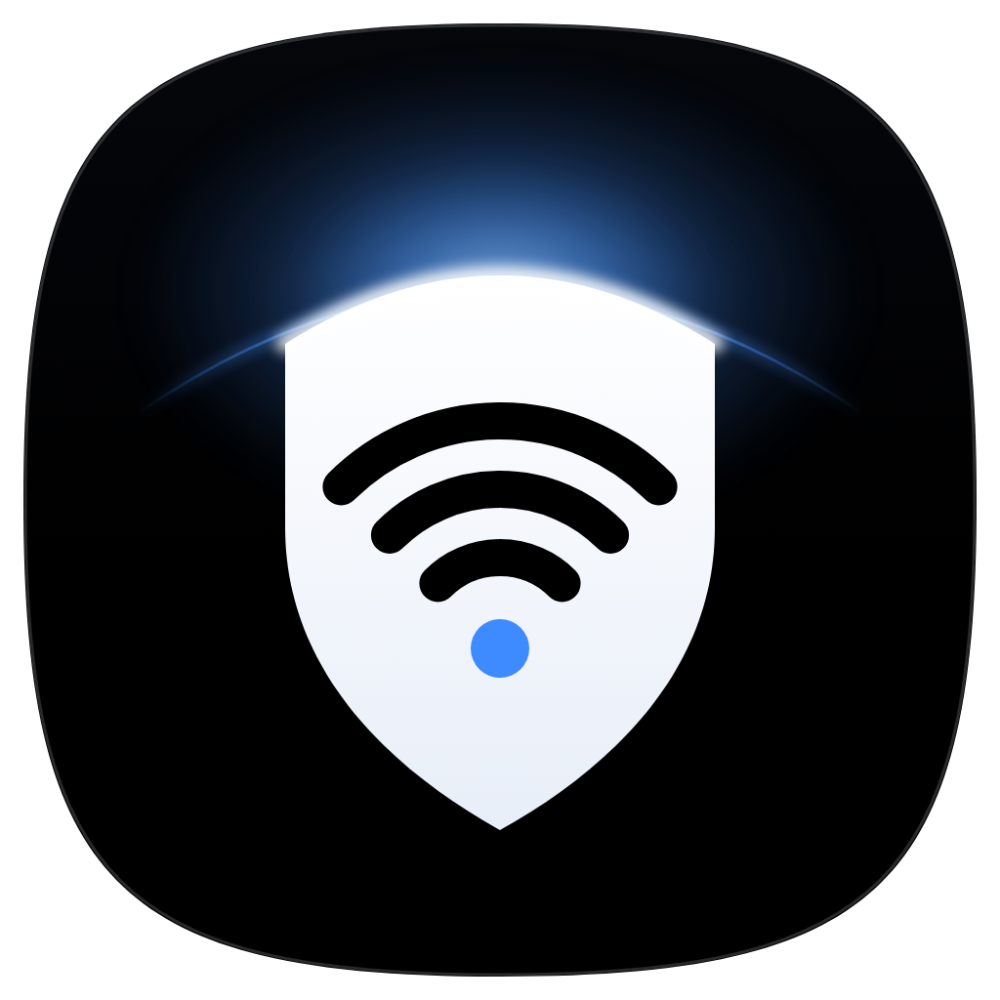

<div align="center">



# Bastion

**Close your router's backdoors, see where your traffic goes, speed up your Wi-Fi, and let AI agents watch your network for you.**

Desktop app for Windows and macOS. Free, open source, no account.

[Download](../../releases/latest) · [Build from source](#build-from-source) · [Privacy](#privacy) · [Security policy](SECURITY.md)

</div>


> Screenshot placeholder: add `docs/screenshots/home.png` (recommended 2880x1840, dark UI) before the first public release.

---

## What Bastion does

**Finds the doors into your home network, and helps you close them.**
One scan checks your router from the inside and explains each finding in plain language, with the evidence it observed and the exact steps to fix it.

| Check | What it looks for |
| --- | --- |
| Provider remote management (TR-069) | The CWMP port (7547) answering on your router, which lets your ISP, or whoever compromises it, reconfigure the router remotely |
| UPnP | Whether any program on your network can open ports on the router, and which port mappings are open right now |
| Telnet / SSH | Unencrypted or unnecessary remote shells on the router |
| Plain-HTTP admin page | A router admin panel that sends your password unencrypted |
| Router admin page | Whether the router's admin page is reachable from this computer and what it identifies as. Bastion never submits a login or tries any password |
| Plain-text DNS | Whether this computer's DNS lookups go out unencrypted, readable by your ISP and anyone on the path |
| WPS | Push-button / PIN pairing, a common way in |
| Wi-Fi security | Open, WEP or WPA (1) networks |
| Location mapping | Whether your Wi-Fi name opts out of public location databases |
| MAC privacy | Whether this computer uses a private (randomized) hardware address |
| Unknown devices | Devices on your network you may not recognize |

**Encrypted DNS.** Shows which DNS servers this computer really uses, whether they are your router or ISP, and whether lookups are encrypted. Then guides you to encrypted DNS (Cloudflare, Quad9, Google, or your own choice) in the way your system allows: Windows 11 has a DNS over HTTPS option in Settings; Windows 10 and macOS have no Settings switch for it, so the guide covers turning on encrypted DNS on your router or installing the provider's DNS over HTTPS profile or app.

**Wi-Fi channel tuning.** Surveys nearby networks, shows how crowded each channel is, and recommends a quieter channel with the numbers behind it ("4 networks on your channel now, 0 on channel 44"). Plus a real speed test: ping, jitter, download and upload.

**Device list.** Everything your computer can see on the local network, with vendor names, gateway and this-computer markers, and a flag for randomized addresses.

**Where your traffic goes.** Live connections from this computer: which program talks to which address and port.

**AI watchers with your own key.** Connect Claude (Anthropic), ChatGPT (OpenAI) or Grok (xAI) with your own API key. Agents read a snapshot of your scan results and answer questions like "is anything here dangerous?" or "why is my Wi-Fi slow in the evening?". They answer and suggest steps; you carry out any change yourself. Agents cannot change anything on your computer or router.

## What it does NOT do

Bastion is honest about what one computer can and cannot see. Where it cannot measure something, it says **unknown** and tells you how to find out yourself. It never shows made-up numbers.

- **It cannot see other devices' traffic.** Your laptop only sees its own connections. Per-device traffic for phones, TVs and cameras needs router integration, which is on the roadmap.
- **It cannot prove what is exposed to the internet.** All checks run from inside your network. A port open on the LAN side is a strong hint, not proof of WAN exposure. Bastion tells you which external check to run if you want certainty.
- **It never logs in to your router and never tries passwords.** No brute force, no default-credential guessing, no exploits. It only looks at what your router openly answers.
- **It never changes settings without you.** Every fix is a guided fix: steps plus a button that opens the right settings page or your router's admin page. You make the change. AI agents can only suggest.
- **It is not antivirus** and does not inspect the content of your traffic.

## Privacy

Bastion has no account, no telemetry, no analytics and no crash reporting. Exactly these things leave your machine:

| Destination | When | What is sent |
| --- | --- | --- |
| Cloudflare speed test (`speed.cloudflare.com`) | Only when you press Run speed test | Test traffic, nothing about you beyond your IP address |
| `api.ipify.org` | When the overview loads | A request that returns your public IP address |
| Anthropic, OpenAI or xAI API | Only when you ask an agent a question | Your question and the network snapshot shown in the app, with your own API key |

Everything else stays on your local network: the scan talks only to your router's LAN address and uses standard local discovery (UPnP / SSDP). The device list reads this computer's ARP cache (no ping sweep); to show device names it sends reverse-DNS (PTR) lookups for local addresses to the DNS server your system is configured with, which is usually your router but can be your ISP's or a public resolver. Your API keys are encrypted at rest with the operating system's keychain (Electron `safeStorage`) and are sent only to the provider they belong to. AI providers handle what you send under their own terms; review them before you connect a key.

## Tip: keep your Wi-Fi off location maps

Phones constantly report the Wi-Fi networks they see, which lets location services map your router to your home address. Add **`_nomap`** to the end of your Wi-Fi name (for example `HomeNet_nomap`) to opt out. Google honors it, and some other location services do too. It does not hide your network from people nearby; it only asks mapping services not to record it. Bastion's "Location mapping" check tells you whether your network name already has it.

## Install

Download the latest build from **[Releases](../../releases/latest)**:

- **Windows 10/11:** `Bastion-<version>-win-x64.exe` or `Bastion-<version>-win-arm64.exe`
- **macOS 13+:** `Bastion-<version>-mac-universal.dmg` (Apple Silicon and Intel)

Builds are not code-signed yet. On Windows, SmartScreen may show "Windows protected your PC": choose **More info**, then **Run anyway**. On macOS (ad-hoc signed, not notarized), open Bastion once and close the warning, then go to **System Settings > Privacy & Security**, scroll down and click **Open Anyway**. If macOS still refuses, run `xattr -dr com.apple.quarantine /Applications/Bastion.app` in Terminal. Signed and notarized builds are on the roadmap.

Both systems treat Wi-Fi names and channels as location data. Without location permission, Wi-Fi fields show "unknown" and Bastion says why.

- **Windows 11:** Settings > Privacy & security > Location: turn on **Location services** and **Let desktop apps access your location**.
- **macOS:** System Settings > Privacy & Security > Location Services: allow **Bastion** (it is listed after Bastion first asks for access).

## Build from source

You need [Node.js](https://nodejs.org) 24 or newer and git.

```bash
git clone https://github.com/<owner>/bastion.git
cd bastion
npm ci
npm start              # run the app
npm run dev            # run with DevTools
```

Package installers:

```bash
npm run dist:win       # Windows NSIS installers (x64 and ARM64) -> dist/
npm run dist:mac       # macOS universal DMG -> dist/ (run on a Mac)
```

Other scripts:

```bash
npm run preview        # renderer only, in a browser at http://127.0.0.1:5174, with mock data
npm run check          # node --check on every .js file, then a load test of engine/ and agents/
npm run icon           # re-render build/icon.png from build/icon.svg
```

Tagged pushes (`v*`) build both platforms in GitHub Actions and attach the installers to a draft release.

## Project structure

```
electron/      Main process: window, menu, IPC handlers; preload exposes window.bastion
engine/        Network engine: scans, Wi-Fi, DNS, speed test (Node built-ins only)
agents/        AI providers (Claude, ChatGPT, Grok) and encrypted key storage
renderer/      The UI: index.html, styles/ (design tokens), js/ (ES modules, three.js hero)
scripts/       Dev tooling: preview server, syntax check, icon renderer
build/         App icon (SVG source + rendered PNG) for packaging
docs/          CONTRACT.md (module boundaries and IPC types), design reference
.github/       CI workflow and issue templates
```

`docs/CONTRACT.md` is the source of truth for how these pieces talk to each other.

## Roadmap

- **Router integrations:** read-only APIs for popular routers and mesh systems (UniFi, OpenWrt, FRITZ!Box, ASUS, Keenetic, MikroTik) for facts that cannot be seen from a laptop.
- **Per-device traffic** via router APIs: which device talks to where, and how much.
- **Automatic fixes**, opt-in, with a preview of every change and one-click undo, only through official router APIs.
- **External exposure check** that confirms from outside which ports are actually reachable from the internet.
- **Signed and notarized builds**, auto-update, and a Linux build.
- **Scheduled watch** with notifications when a new device joins or a closed door reopens.

## Disclaimer

Bastion is provided as is, without warranty of any kind. It gives guidance based on what it can observe from your computer; it cannot guarantee that your network is secure. Only scan networks you own or are allowed to test. Changing router settings can interrupt your connection: write down the current values before you change them. Bastion is not affiliated with any router vendor, ISP, Anthropic, OpenAI or xAI; product names belong to their owners.

## License

[MIT](LICENSE) © 2026 Bastion contributors
